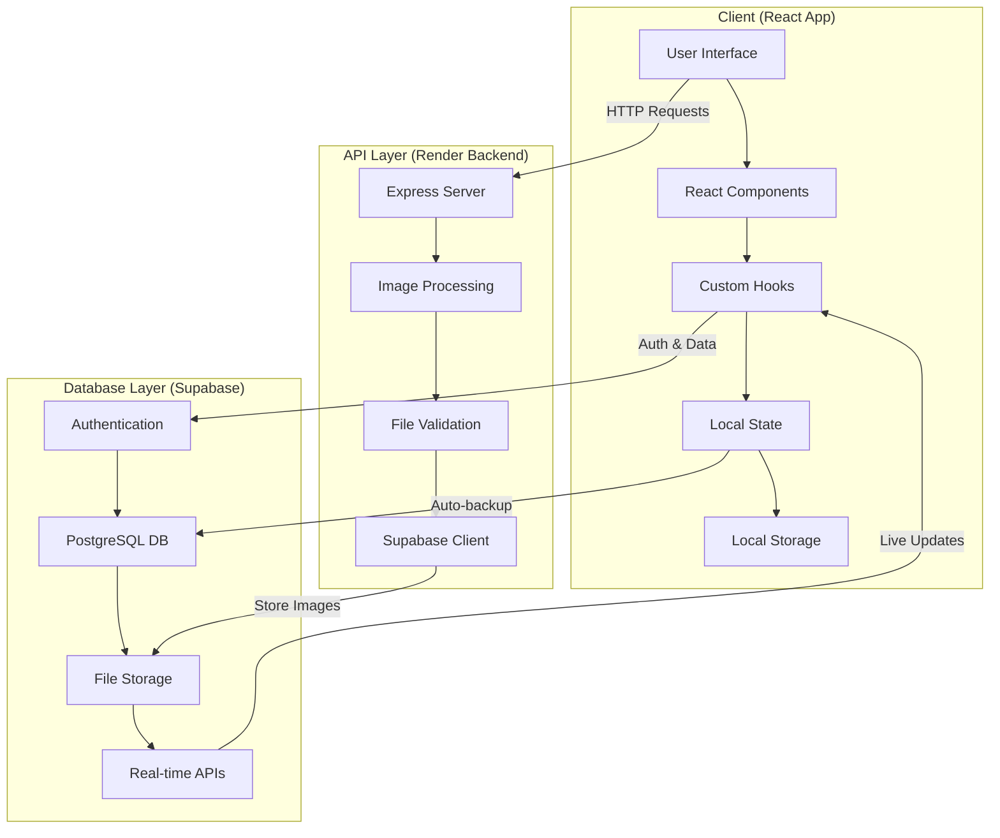

# Auction Dugout

A comprehensive web-based cricket auction management system with real-time bidding, team management, WhatsApp integration, and cloud backup capabilities.

## 🏆 Features

- **🔐 User Authentication:** Secure login/signup with Supabase authentication
- **📊 Player & Team Management:** Upload CSV files to quickly add players and teams with detailed validation
- **⚙️ Category Configuration:** Configure auction settings per player category with smart validation
- **🎯 Live Auction Interface:** Real-time bidding with player photos, category selection, and auction rounds
- **💾 Auto-Backup & Restore:** Automatic cloud and local state persistence with session restoration
- **📱 WhatsApp Integration:** Send auction updates and team summaries directly to WhatsApp groups
- **📈 Analytics Dashboard:** Max bid analysis, team overview, and comprehensive auction statistics
- **🎨 Modern UI/UX:** Responsive design with animations, toasts, emojis, and dark theme

## 🚀 Getting Started

### Prerequisites
- Node.js (v14 or higher)
- npm or yarn package manager
- Supabase account (for authentication and cloud storage)

### Installation
1. Clone the repository
```bash
git clone <repository-url>
cd auction-dugout
```

2. Install dependencies
```bash
npm install
```

3. Setup environment variables
Create a `.env` file in the root directory:
```env
REACT_APP_SUPABASE_URL=your_supabase_url
REACT_APP_SUPABASE_ANON_KEY=your_supabase_anon_key
REACT_APP_API_BASE_URL=your_backend_api_url
```

4. Start the development server
```bash
npm start
```

## 📋 User Guide

### Authentication & Setup
1. **Sign In/Sign Up**
   - Access the application through your web browser
   - Sign in with email/password or create a new account
   - All data is securely stored and synced to your account

2. **Tournament Setup**
   - Enter a tournament name (minimum 3 characters)
   - The tournament name appears in the scrolling ticker

### Data Upload & Configuration

3. **Upload Players CSV**
   - **Required columns:** Name, Skillset, Photo Link, Category, CricHeroes_Profile (optional)
   - **Supported categories:** PLATINUM, ICON, GOLD, SILVER, OPEN, or custom categories
   - **Photo support:** Google Drive links, direct URLs, automatic image processing
   - Download sample CSV template from the interface

4. **Upload Teams CSV**
   - **Required columns:** Team Name, Owner Name, Total Points, Total Players to Buy, Owner Retained, Owner Retained at, Owner Category
   - **Owner retention:** Automatic deduction from team budget and player count
   - Download sample CSV template from the interface

5. **Category Configuration**
   - Set players to buy per category (cannot exceed available players)
   - Set base price per category (cannot exceed team budget)
   - Real-time validation with visual feedback
   - Automatic calculation of total requirements vs. team capacity

### Auction Management

6. **Live Auction**
   - **Category Selection:** Choose from available player categories
   - **Player Display:** High-quality photos, detailed player information, CricHeroes profiles
   - **Bidding Interface:** Team selection, bid amount input, confirmation dialogs
   - **Real-time Updates:** Automatic progress tracking, confetti animations
   - **Round Management:** Multiple rounds, unsold player handling

7. **Team Management**
   - **Team Overview:** Current squad, remaining budget, players needed
   - **Player Editing:** Transfer players between teams, adjust prices
   - **Export Options:** CSV export of team rosters
   - **WhatsApp Sharing:** Send team summaries to WhatsApp groups

8. **Analytics & Reports**
   - **Max Bid Analysis:** Highest/lowest bids, category breakdowns
   - **Auction Statistics:** Total spending, average prices, team comparisons
   - **Export Reports:** CSV exports of all auction data

### Advanced Features

9. **WhatsApp Integration**
   - Configure WhatsApp settings for group notifications
   - Automatic messages for player sales and auction updates
   - Team roster sharing with formatted messages

10. **Backup & Restore**
    - **Auto-save:** Progress saved every few minutes to cloud and local storage
    - **Session Restore:** Automatic recovery of previous sessions on startup
    - **Manual Backup:** Export/import complete auction state

## 📁 File Formats

### Players CSV Structure
| Column | Type | Required | Description | Example |
|--------|------|----------|-------------|---------|
| Name | String | Yes | Player's full name | "Virat Kohli" |
| Skillset | String | Yes | Primary skill | "Batsman", "Bowler", "All Rounder", "Wicket Keeper" |
| Photo Link | URL | Yes | Player photo URL | "https://example.com/photo.jpg" |
| Category | String | Yes | Player category | "PLATINUM", "ICON", "GOLD", "SILVER", "OPEN" |
| CricHeroes_Profile | URL | No | CricHeroes profile link | "https://cricheroes.com/player-profile/123/player" |

### Teams CSV Structure
| Column | Type | Required | Description | Example |
|--------|------|----------|-------------|---------|
| Team Name | String | Yes | Unique team name | "Mumbai Indians" |
| Owner Name | String | Yes | Team owner name | "Mukesh Ambani" |
| Total Points | Number | Yes | Team budget | "80000000" |
| Total Players to Buy | Number | Yes | Squad size needed | "25" |
| Owner Retained | String | Yes | "Yes" or "No" | "Yes" |
| Owner Retained at | Number | Conditional | Cost if retained | "15000000" |
| Owner Category | String | Conditional | Owner's category if retained | "PLATINUM" |

## 🛠️ Technologies Used

### Frontend Stack
- **React 18.2.0** - Modern React with hooks and functional components
- **JavaScript (ES6+)** - Modern JavaScript features and syntax
- **Tailwind CSS 4.1.11** - Utility-first CSS framework for styling
- **Framer Motion 12.23.7** - Animation library for smooth UI transitions
- **React Hot Toast 2.5.2** - Toast notifications and user feedback
- **React Confetti 6.4.0** - Celebratory animations for auction events

### Backend & API
- **Node.js with Express 5.1.0** - Server-side runtime and web framework
- **Supabase** - Backend-as-a-Service for authentication and data storage
- **CORS 2.8.5** - Cross-origin resource sharing middleware
- **Multer 2.0.2** - File upload handling middleware
- **Node Fetch 3.3.2** - HTTP client for server-side requests

### Data Processing
- **Papa Parse 5.4.1** - CSV parsing and processing library
- **CSV Parser 3.2.0** - Additional CSV handling utilities
- **Axios 1.11.0** - HTTP client for API requests

### Development Tools
- **React Scripts 5.0.1** - Build tools and development server
- **PostCSS 8.5.6** - CSS post-processing
- **Autoprefixer 10.4.21** - CSS vendor prefixing
- **ESLint 8.57.1** - JavaScript linting and code quality
- **TypeScript ESLint 8.37.0** - TypeScript support for ESLint

## 📂 Project Architecture

```
auction-dugout/
├── public/                         # Static assets
│   ├── index.html                  # Main HTML template
│   └── favicon.ico                 # App favicon
│
├── src/                            # Source code
│   ├── components/                 # React components
│   │   ├── AuctionInterface.js     # Main auction bidding interface
│   │   ├── AuthPage.js             # User authentication page
│   │   ├── CategoryConfig.js       # Category configuration with validation
│   │   ├── CategorySelection.js    # Category selection modal
│   │   ├── ConfirmationDialogs.js  # Modal confirmation dialogs
│   │   ├── FileUpload.js           # CSV file upload with progress
│   │   ├── JerseyColorAssignment.js # Team jersey color assignment
│   │   ├── MaxBidPage.js           # Auction analytics and max bid analysis
│   │   ├── PlayerImage.js          # Player photo display component
│   │   ├── PlayerInfo.js           # Player details display
│   │   ├── PlayerSpinWheel.js      # Random player selection wheel
│   │   ├── ResetConfirmation.js    # Auction reset confirmation
│   │   ├── TeamsPage.js            # Team management and overview
│   │   ├── TournamentSetup.js      # Tournament name setup
│   │   └── WhatsAppSettings.js     # WhatsApp integration settings
│   │
│   ├── hooks/                      # Custom React hooks
│   │   ├── useAuth.js              # Authentication logic
│   │   ├── useAuction.js           # Core auction state management
│   │   ├── useAuctionBusinessLogic.js # Auction business rules and logic
│   │   ├── useAutoSave.js          # Automatic data persistence
│   │   ├── usePersistence.js       # Cloud and local data backup
│   │   ├── useStartupRestore.js    # Session restoration on startup
│   │   ├── useToastManager.js      # Toast notification management
│   │   └── useWhatsAppIntegration.js # WhatsApp messaging integration
│   │
│   ├── utils/                      # Utility functions
│   │   ├── constants.js            # App constants, emojis, and styles
│   │   ├── csvUtils.js             # CSV parsing and validation utilities
│   │   └── whatsappUtils.js        # WhatsApp message formatting
│   │
│   ├── App.js                      # Main application component and routing
│   ├── index.js                    # React app entry point
│   ├── index.css                   # Global styles and Tailwind imports
│   └── supabaseClient.js           # Supabase client configuration
│
├── server.js                       # Express.js backend server
├── download_player_images.js       # Player image processing script
├── package.json                    # Project dependencies and scripts
├── postcss.config.js               # PostCSS configuration
├── tailwind.config.js              # Tailwind CSS configuration
├── .env                            # Environment variables (not in repo)
└── README.md                       # Project documentation
```

## 🏗️ Key Architecture Patterns

- **Component-Based Architecture:** Modular React components for reusability and maintainability
- **Custom Hooks Pattern:** Business logic separated into reusable hooks for clean separation of concerns
- **State Management:** React hooks with automatic cloud and local persistence
- **Real-time Validation:** Smart form validation with visual feedback and error handling
- **Progressive Enhancement:** Graceful fallbacks for offline functionality
- **Responsive Design:** Mobile-first approach with adaptive layouts

## 🏗️ Application Architecture

### System Overview
Auction Dugout follows a **3-tier architecture** with clear separation of concerns:

```
┌─────────────────┐    ┌─────────────────┐    ┌─────────────────┐
│   Frontend      │    │   Backend       │    │   Database      │
│   (React App)   │ ◄─►│ (Render/Express)│ ◄─►│   (Supabase)    │
└─────────────────┘    └─────────────────┘    └─────────────────┘
```

### Detailed Architecture Layers

#### 1. **Presentation Layer (React Frontend)**
- **Components**: Modular UI components with single responsibilities
- **Hooks**: Custom business logic hooks for state management
- **Utils**: Shared utilities for validation, formatting, and constants
- **State Management**: React hooks + Context for global state
- **Local Storage**: Client-side persistence for offline capability

#### 2. **API Layer (Express Backend on Render)**
- **Image Processing**: Download, optimize, and upload player photos
- **File Handling**: CSV processing and validation
- **CORS**: Cross-origin resource sharing for frontend communication
- **Error Handling**: Robust error responses and logging

#### 3. **Data Layer (Supabase)**
- **Authentication**: User management and session handling
- **Database**: PostgreSQL for auction state persistence
- **Storage**: File storage for player images
- **Real-time**: WebSocket connections for live updates
- **RLS**: Row Level Security for data protection

### Component Architecture Patterns

#### **Custom Hooks Pattern**
```javascript
// Business logic separation
useAuth()              // Authentication state
useAuction()           // Core auction logic  
usePersistence()       // Data backup/restore
useWhatsAppIntegration() // Messaging features
```

#### **Component Hierarchy**
```
App.js (Root)
├── AuthPage (Authentication)
├── TournamentSetup (Initial setup)
├── FileUpload (Data import)
├── CategoryConfig (Auction setup)
├── AuctionInterface (Main auction)
├── TeamsPage (Team management)
├── MaxBidPage (Analytics)
└── Various Modals & Dialogs
```

## 🔄 Data Flow Architecture

### Complete Data Flow Diagram



### Data Flow Scenarios

#### **1. User Authentication Flow**
```
User Login → React (useAuth) → Supabase Auth → JWT Token → Session Storage
     ↓
User State Updates → App Re-render → Authenticated Routes Available
```

#### **2. Player Data Upload Flow**
```
CSV Upload → FileUpload Component → Papa Parse → Validation
     ↓
Player Data → Backend API (Render) → Image Processing → Supabase Storage
     ↓
Processed URLs → Frontend State → Local Storage → UI Update
```

#### **3. Image Processing Flow**
```
Photo URL → Backend Fetch → Google Drive Conversion → Image Download
     ↓
Buffer Creation → Supabase Upload → CDN URL → Frontend Display
```

#### **4. Auction State Persistence Flow**
```
User Action → State Update → useAutoSave Hook → Dual Persistence:
     ├── Local Storage (Immediate)
     └── Supabase Database (Cloud Backup)
```

#### **5. Real-time Updates Flow**
```
Bid Placed → State Update → usePersistence → Supabase Database
     ↓
WhatsApp Integration → Formatted Message → External API → Group Notification
```

### Data Persistence Strategy

#### **Multi-layer Backup System**
1. **Immediate**: React state (in-memory)
2. **Short-term**: Local Storage (browser)
3. **Long-term**: Supabase Database (cloud)
4. **Recovery**: Session restoration on startup

#### **Data Synchronization**
```javascript
// Auto-save every 30 seconds
useAutoSave(players, teams, auction, persistence, authUser);

// Manual save on critical actions
await persistence.saveState(currentState);

// Startup restore
const restored = await persistence.loadState();
```

### API Endpoints & Data Flow

#### **Backend API Endpoints (Render)**
```javascript
POST /api/upload-player
├── Input: { name, skill, category, photoUrl }
├── Process: Download image → Upload to Supabase
└── Output: { image_url, player_data }
```

#### **Supabase Integration Points**
```javascript
// Authentication
supabase.auth.signIn()
supabase.auth.getUser()

// Data Storage  
supabase.from('auction_states').upsert(data)
supabase.from('auction_states').select()

// File Storage
supabase.storage.from('player-images').upload()
supabase.storage.from('player-images').getPublicUrl()
```

### State Management Architecture

#### **Global State Flow**
```
App.js (State Container)
├── players[] (Player data)
├── teams{} (Team information)  
├── tournamentName (Tournament info)
├── categoryConfigs{} (Auction settings)
├── whatsappSettings{} (Integration config)
└── auction{} (Live auction state)
```

#### **Hook Dependencies**
```
useAuth → usePersistence → useAutoSave
   ↓            ↓             ↓
User Session → Cloud Backup → Auto-save Timer
```

### Security Architecture

#### **Authentication & Authorization**
- **JWT Tokens**: Secure session management
- **RLS Policies**: Row-level security in Supabase
- **CORS**: Controlled cross-origin access
- **Environment Variables**: Secure API key management

#### **Data Protection**
- **Client-side Validation**: Input sanitization
- **Server-side Validation**: Backend verification  
- **Encrypted Storage**: Supabase encryption at rest
- **HTTPS**: Secure data transmission

### Performance Optimization

#### **Frontend Optimizations**
- **React.memo**: Component memoization
- **useMemo/useCallback**: Expensive calculation caching
- **Code Splitting**: Lazy loading components
- **Image Optimization**: CDN delivery via Supabase

#### **Backend Optimizations**
- **Image Processing**: Automated compression
- **Caching**: 1-hour cache headers
- **Connection Pooling**: Efficient database connections
- **Error Handling**: Graceful fallbacks

### Deployment Architecture

#### **Frontend Deployment (Vercel/Netlify)**
```
GitHub → Build Process → Static Assets → CDN Distribution
```

#### **Backend Deployment (Render)**
```
GitHub → Docker Container → Express Server → Auto-scaling
```

#### **Database (Supabase)**
```
Managed PostgreSQL → Automatic Backups → Global CDN
```

This architecture ensures **scalability**, **reliability**, and **maintainability** while providing a seamless user experience for cricket auction management.

## 🔧 Configuration

### Environment Variables
```env
# Supabase Configuration
REACT_APP_SUPABASE_URL=https://your-project.supabase.co
REACT_APP_SUPABASE_ANON_KEY=your-anon-key

# API Configuration
REACT_APP_API_BASE_URL=https://your-backend-api.com
```

### Supabase Setup
1. Create a new Supabase project
2. Enable authentication with email/password
3. Create necessary tables for data storage
4. Configure RLS (Row Level Security) policies
5. Add environment variables to your `.env` file

## 🤝 Contributing

1. Fork the repository
2. Create a feature branch (`git checkout -b feature/amazing-feature`)
3. Commit your changes (`git commit -m 'Add amazing feature'`)
4. Push to the branch (`git push origin feature/amazing-feature`)
5. Open a Pull Request

## 📄 License

This project is licensed under the MIT License - see the LICENSE file for details.

## 🙏 Acknowledgments

- **Powered by:** [Amit Gandhi](https://www.linkedin.com/in/amitajitgandhi/)
- **Built with:** React, Supabase, Tailwind CSS
- **Special thanks to:** Cricket community for inspiration and feedback

## 📞 Support

For support, questions, or feature requests:
- **WhatsApp:** [+91 7276319578](https://wa.me/+917276319578)
- **LinkedIn:** [Amit Gandhi](https://www.linkedin.com/in/amitajitgandhi/)
- **Email:** Contact through LinkedIn or WhatsApp

---

**Auction Dugout** - Making cricket auctions exciting, organized, and professional! 🏏✨
